<div align="center">
  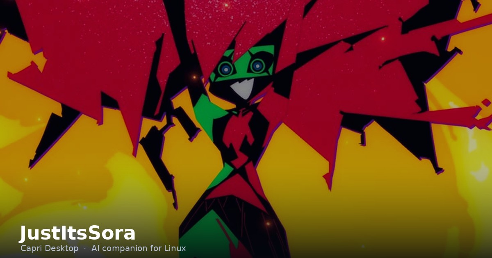
</div>

<h1 align="center">JustItsSora</h1>

<p align="center">
  <b>Desarrollador de software</b><br>
  Herramientas de escritorio y utilidades para Linux · C# · Python · Rust
</p>

<p align="center">
  <a href="https://github.com/kyuog/capri-desktop-linux"></a>
  <a href="https://github.com/kyuog/kabe"></a>
  <a href="https://github.com/kyuog/vaporstrap"></a>
</p>

<p align="center">
  
  
  
  
</p>

---

## Sobre mí

Programo sobre Linux y me gusta que las herramientas sean **ligeras, nativas y
sin capas de más**. La mayor parte de lo que construyo son aplicaciones de
escritorio y utilidades que resuelven algo concreto del día a día: controlar
ventanas, cambiar el fondo de pantalla, lanzar un juego o darle manos y ojos a
un asistente.

- Trabajo principalmente en **C# / .NET** y **Python**, con **Rust** para lo que
  necesita ser rápido y **GTK3** para la interfaz.
- Me interesan los binarios de un solo archivo, la integración real con X11 y
  Wayland, y las herramientas que no piden un navegador embebido para existir.
- Cuando algo del software libre no encaja en Linux, lo adapto y lo publico.

## Estadísticas

<p align="center">
  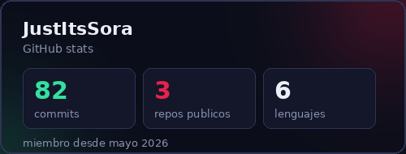
  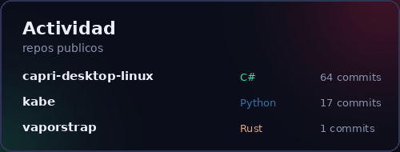
</p>

<p align="center">
  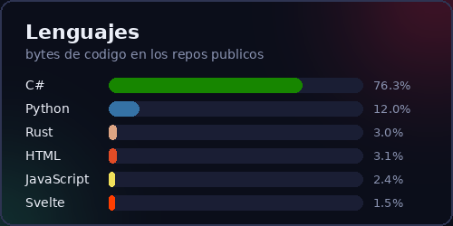
  <a href="https://github.com/kyuog"></a>
</p>

## Proyectos

### Capri Desktop — asistente de escritorio con IA
<a href="https://github.com/kyuog/capri-desktop-linux"></a>


Fork comunitario de Capri, la mascota de escritorio con IA. Esta versión hace
que el build de Linux sea realmente útil: **control de ventanas en X11**, manos
para teclado, ratón, portapapeles, recordatorios y energía, cerebros en la nube
(NVIDIA, OpenAI, Claude) y binarios de un solo archivo.

```bash
./build-linux.sh
./out/linux/Capri --hands "abre Firefox y busca el clima"
```

### Kabe — fondos de pantalla en alta resolución
<a href="https://github.com/kyuog/kabe"></a>


Descubridor y aplicador de fondos de pantalla para Linux. Indexa repositorios
de GitHub sin clonarlos, busca con tolerancia a errores de tipeo sobre SQLite
FTS5 y aplica el fondo en el escritorio real, con vista previa por monitor.
Sin navegador embebido ni Electron.

### Vaporstrap — lanzador de Roblox para Linux
<a href="https://github.com/kyuog/vaporstrap"></a>


Bootstrapper de código abierto para jugar Roblox de forma nativa en Linux:
editor de FastFlags, perfiles de rendimiento, mods, Discord RPC y multi-cuenta
sobre un motor externo. Sin Wine, sin emulador y sin máquina virtual.

## Capri en acción

<p align="center">
  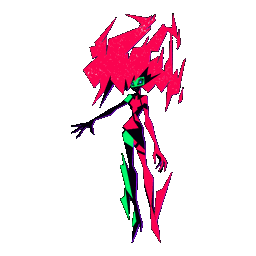
  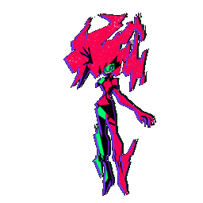
  
  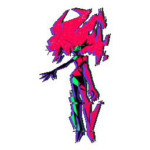
</p>
<p align="center">
  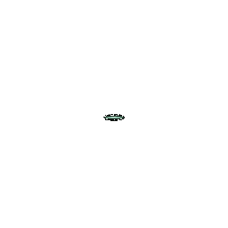
  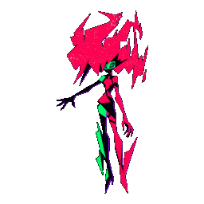
  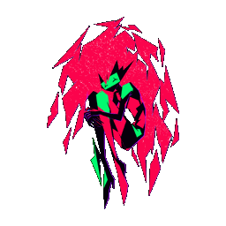
  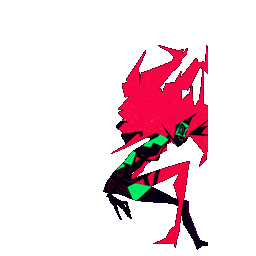
</p>

---

<p align="center">
  <sub>Hecho en Linux, con C#, Python y Rust.</sub>
</p>
